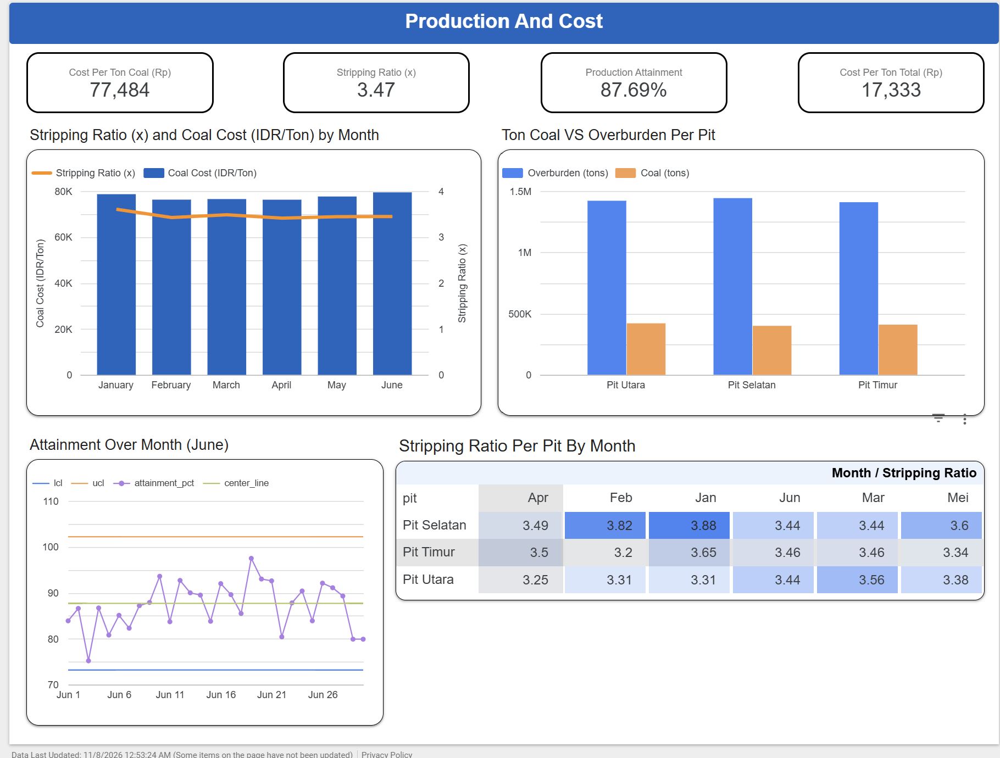
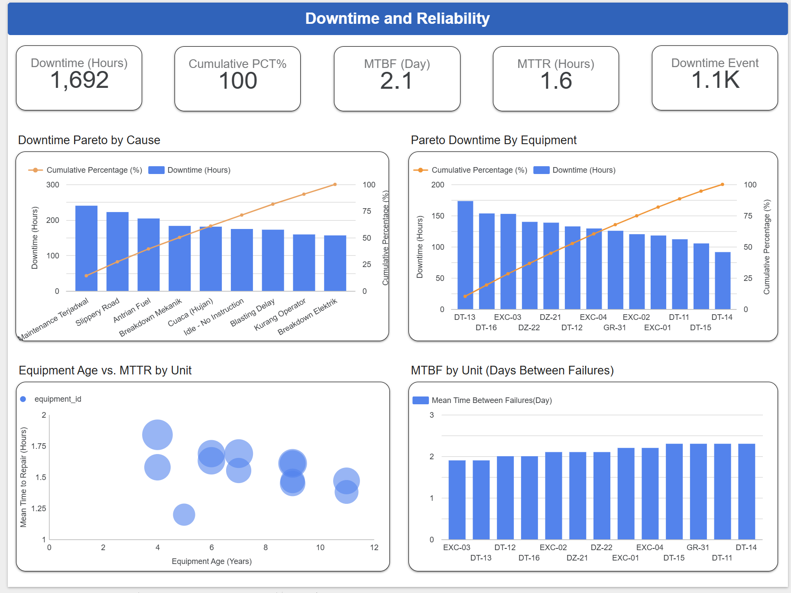

# Mine Operations KPI: Stripping Ratio, Downtime & Equipment Reliability

> **End-to-end analytics project** using PostgreSQL (SQL) and Looker Studio to evaluate coal mine operations: production attainment, stripping ratio, cost per ton, downtime causes, and heavy equipment reliability.

---

## Table of Contents

1. [Business Understanding](#1-business-understanding)
2. [Data Source](#2-data-source)
3. [Environment & Tech Stack](#3-environment--tech-stack)
4. [Data Cleaning](#4-data-cleaning)
5. [Data Extraction & Feature Engineering](#5-data-extraction--feature-engineering)
6. [Key Findings](#6-key-findings)
7. [Dashboard](#7-dashboard)
8. [Insights & Recommendations](#8-insights--recommendations)
9. [Limitations & Methodology Notes](#limitations--methodology-notes)

---

## 1. Business Understanding

### 1.1 Business Background

This case study simulates an open-pit coal mine with **3 pits** (Pit Utara, Pit Selatan, Pit Timur) running **2 shifts per day** (Shift 1 Day, Shift 2 Night). Each day the mine moves two material types: **Coal** (the saleable product) and **Overburden** (waste rock and soil that must be removed to reach the coal).

Operations rely on **13 heavy equipment units** (4 Excavators, 6 Dump Trucks, 2 Dozers, 1 Grader) and six cost categories: Fuel, Hauling Contractor, Maintenance & Sparepart, Labor & Overtime, Blasting Material, and Miscellaneous (Lain-lain).

The data covers **January 1 – June 30, 2026 (181 days)**: daily actual vs. planned production, equipment downtime records, and daily operating costs.

### 1.2 Business Problem

The operations team needs a single source of truth to answer three connected problems:

- **Problem 1: Production below plan.** Actual output has not reached plan. How large is the gap, is it sporadic or systemic, and does hauling distance play a role?
- **Problem 2: Cost efficiency.** Cost needs to be read per ton rather than in total rupiah, and related to the stripping ratio (waste moved per ton of coal).
- **Problem 3: Lost equipment time (downtime).** Downtime is spread across many causes and units. Which causes and units deserve priority?

### 1.3 Project Objectives

| # | Objective | Analysis Focus |
| --- | --- | --- |
| 1 | Measure stripping ratio and cost per ton of coal (monthly and per pit) | Stripping Ratio & Cost |
| 2 | Test whether hauling distance is related to production attainment | Hauling Distance |
| 3 | Identify the largest downtime causes and contributing units | Downtime Pareto |
| 4 | Assess equipment reliability (MTTR, MTBF proxy, equipment age) | Equipment Reliability |
| 5 | Determine whether daily attainment is stable or has out-of-control days | Control Chart (SPC) |

### 1.4 Key Business Questions (KBQ)

**Objective 1: Stripping Ratio & Cost**
- What is the monthly stripping ratio, and which pit is highest?
- How did cost per ton of coal trend over six months, and what drove it?
- Which cost category dominates?

**Objective 2: Hauling Distance**
- Does attainment drop as hauling distance increases?

**Objective 3: Downtime Pareto**
- Which causes contribute the most downtime hours, and how concentrated are they?
- Which units stop most often and for the longest?

**Objective 4: Reliability**
- Which units have the highest MTTR and shortest MTBF?
- Do older machines tend to have more problems?

**Objective 5: Control Chart**
- Is daily production statistically in control, and at what level is it stable?

---

## 2. Data Source

**Source:** simulated (synthetic) mine operations dataset, 2026-01-01 to 2026-06-30.

| Source Table | Description | Rows (raw) | Columns |
| --- | --- | --- | --- |
| `daily_production` | Plan vs. actual tonnage per date, pit, shift, and material | 2,197 | 8 |
| `equipment_downtime` | Downtime events per equipment unit | 1,085 | 7 |
| `cost_production` | Daily cost per category (IDR) | 1,086 | 3 |
| `equipment_master` | Equipment master (type, model, year operational, fuel capacity) | 13 | 5 |

**Data range:** 181 days (Jan 1 – Jun 30, 2026)
**`daily_production` grain:** date × pit × shift × material type

> Column values and view column names (e.g. `penyebab` = cause, `bucket_jarak` = distance bucket, `bulan` = month) are kept in their original Indonesian.

---

## 3. Environment & Tech Stack

**Tools:** PostgreSQL (cleaning, feature engineering, VIEWs) · Looker Studio (dashboard)
**Workflow:** raw CSV → `raw` schema → `clean` schema → 8 analytical VIEWs (`vw_lk_*`) → exported to CSV → Looker Studio data source

```
raw CSV  →  raw.*  →  clean.*  →  vw_lk_* (8 views)  →  CSV  →  Looker Studio
```

---

## 4. Data Cleaning

All cleaning was done in PostgreSQL, producing `clean.*` tables that are the foundation for every downstream analysis. Full script: [`mine_operation.sql`](SQL%20Script/mine_operation.sql)

### 4.1 Cleaning Strategy per Table

**`clean.daily_production`**
- Deduplication with `ROW_NUMBER()` partitioned across all eight columns, keeping only `row_num = 1`: **25 exact duplicate rows** removed (2,197 → 2,172 rows)
- `material_type` standardized with `INITCAP()`: 38 raw rows wrote `coal` / `overburden` in lowercase, which would otherwise be counted as separate categories
- Type casting (`DATE`, `VARCHAR`, `FLOAT4`, `INT`)
- NULLs in `actual_tonnage` (9 rows) and `distance_km` (37 rows) are **not imputed**; they are explicitly excluded in the views that need those fields

**`clean.equipment_downtime`**
- `TRIM()` on `equipment_id`: 18 rows had trailing spaces (e.g. `'DT-11 '`), creating 22 ID variants for only 13 real units
- Imputation of NULL `downtime_hours` (17 rows) with the **median per `downtime_reason`** (`PERCENTILE_CONT(0.5)`), since downtime hours are right-skewed and the median is safer than the mean
- Type casting

**`clean.cost_production`** and **`clean.equipment_master`**
- No NULLs or duplicates found; type casting only

### 4.2 Before vs. After Summary

| Table | Raw Rows | Clean Rows | Issues Handled |
| --- | --- | --- | --- |
| `daily_production` | 2,197 | 2,172 | 25 duplicates, 38 rows with inconsistent casing |
| `equipment_downtime` | 1,085 | 1,085 | 18 `equipment_id` with trailing spaces, 17 NULL `downtime_hours` |
| `cost_production` | 1,086 | 1,086 | None |
| `equipment_master` | 13 | 13 | None |

---

## 5. Data Extraction & Feature Engineering

Each analysis is built as a **flat VIEW** prefixed `vw_lk_`, so Looker Studio only reads ready-made tables with no extra calculation (cumulative Pareto percentages and SPC control limits are computed in SQL).

### 5.1 Metric Definitions

| Metric | Definition |
| --- | --- |
| **Attainment (%)** | `SUM(actual_tonnage) / SUM(plan_tonnage) × 100` |
| **Stripping Ratio (proxy)** | Overburden tons / coal tons. Called a *proxy* because data is recorded in tonnage, not BCM |
| **Cost per Ton (Total)** | Monthly total cost / total tons (coal + overburden) |
| **Cost per Ton (Coal)** | Monthly total cost / coal tons |
| **Distance Bucket** | Quartiles of `distance_km` via `NTILE(4)` (data-driven); rows without distance go to "Tidak diketahui" (unknown) |
| **Pareto** | Downtime hours ranking + `pct_dari_total` (% of total) + `pct_kumulatif` (cumulative %) |
| **MTTR (proxy)** | Average downtime hours per event, per unit |
| **MTBF (proxy)** | Average days between events per unit (`LAG`); units with fewer than 2 events = NULL |
| **Equipment Age** | Latest data year − `year_operational` |
| **Control Chart** | Individuals chart: center line = mean daily attainment, UCL/LCL = mean ± 3σ |

### 5.2 Final Analytical Views

| View | Contents | Used For |
| --- | --- | --- |
| `vw_lk_sr_pit_bulanan` | Coal tons, overburden tons, SR per pit per month | SR per pit bar / heatmap |
| `vw_lk_sr_cost_bulanan` | SR, total cost, cost per ton (total & coal) per month | SR vs. cost/ton combo chart |
| `vw_lk_distance_bucket` | Attainment per distance quartile | Attainment per bucket bar chart |
| `vw_lk_distance_scatter` | Average distance vs. attainment per pit-day | Scatter plot |
| `vw_lk_pareto_penyebab` | Downtime hours & cumulative % per cause | Pareto combo chart |
| `vw_lk_pareto_unit` | Downtime hours & cumulative % per unit | Pareto combo chart |
| `vw_lk_reliability_unit` | MTTR, MTBF, age, events per 30 days per unit | Reliability analysis |
| `vw_lk_control_chart` | Daily attainment, center line, UCL, LCL, control status | SPC time series |

View outputs are available in [`Data/Clean Data/View`](Data/Clean%20Data/View).

---

## 6. Key Findings

### Finding 1: Production Is Stable at ~87.7% of Plan, and the Gap Is Systemic

Across 181 days, **every day is classified "Terkendali" (in control)** on the control chart. Not a single day falls above the UCL or below the LCL.

| Control Chart Parameter | Value |
| --- | --- |
| Center line (mean daily attainment) | 87.7% |
| UCL (+3σ) | 102.2% |
| LCL (−3σ) | 73.2% |
| Lowest / highest daily attainment | 74.2% / 100.1% |
| Out-of-control days | 0 of 181 |

**The insight:** The process is highly consistent, but consistently below 100%. A gap of roughly **12.3 percentage points** versus plan appears almost every day, which points to *common-cause* (system) variation rather than exceptional events. Chasing "bad days" will not be effective; the system itself (capacity, plan quality, routine time losses) needs review.

Attainment by pit and shift is fairly uniform: Pit Selatan 88.2%, Pit Utara 87.6%, Pit Timur 87.2%; Day shift 87.0% vs. Night shift 88.3%.

---

### Finding 2: Hauling Distance Does Not Explain the Production Gap

| Distance Bucket | Range (km) | Rows | Attainment |
| --- | --- | --- | --- |
| Q1 | 1.23 – 3.14 | 541 | 88.5% |
| Q2 | 3.14 – 3.79 | 541 | 86.0% |
| Q3 | 3.79 – 4.56 | 541 | 88.7% |
| Q4 | 4.56 – 6.79 | 503 | 87.6% |
| Unknown | n/a | 37 | 88.7% |

**The insight:** Attainment does not fall as distance grows. The Q1→Q4 pattern moves up and down without direction, and the correlation at pit-day level (543 points) is only **0.03**.

**Important caveat (confounding):** `avg_ton_per_baris` (average tons per row) drops sharply from 3,743 (Q1) to 1,218 (Q4). This is **not a distance effect**; it is a material mix effect. Coal rows are hauled farther on average (4.49 km) than Overburden rows (3.19 km), and Coal rows carry smaller tonnage by nature. When split by material, attainment stays flat (Coal: 87.5–87.9% across all quartiles).

---

### Finding 3: Cost per Ton Is Creeping Up Because Daily Output Fell, Not Because of Stripping Ratio

| Month | Coal Tons | Stripping Ratio | Total Cost (IDR bn) | Cost/Ton Total (IDR) | Cost/Ton Coal (IDR) |
| --- | --- | --- | --- | --- | --- |
| Jan | 205,299 | 3.61 | 16.15 | 17,082 | 78,675 |
| Feb | 195,600 | 3.43 | 14.93 | 17,242 | 76,305 |
| Mar | 212,255 | 3.49 | 16.25 | 17,067 | 76,555 |
| Apr | 209,231 | 3.41 | 15.96 | 17,287 | 76,277 |
| May | 209,659 | 3.44 | 16.28 | 17,477 | 77,668 |
| Jun | 199,688 | 3.45 | 15.87 | 17,869 | 79,474 |

Period totals: **1,231,731 tons of coal** and **4,274,581 tons of overburden** (overall SR ≈ 3.47), with total cost of **IDR 95.4 billion**.

**The insight:**
- Cost per ton (total) rose **4.6%** from January (IDR 17,082) to June (IDR 17,869), and cost per ton of coal hit its peak in June (IDR 79,474).
- Monthly SR is fairly stable (3.41–3.61) and June's SR is unremarkable, so the June increase is **not** driven by SR. Per calendar day, June total production is about 2.9% below January while daily cost is about 1.5% higher. Costs behave like fixed costs while output weakens.
- By pit, **Pit Selatan** has the highest SR (3.60) versus Pit Timur (3.44) and Pit Utara (3.38). Pit Selatan was already highest in January (3.88) and February (3.82).

**Cost structure (total IDR 95.4 billion):**

| Category | Total (IDR bn) | Share |
| --- | --- | --- |
| Fuel | 32.25 | 33.8% |
| Hauling Contractor | 20.09 | 21.0% |
| Maintenance & Sparepart | 17.03 | 17.8% |
| Labor & Overtime | 12.59 | 13.2% |
| Blasting Material | 10.82 | 11.3% |
| Lain-lain (Miscellaneous) | 2.68 | 2.8% |

Fuel and Hauling Contractor together account for almost 55% of cost.

---

### Finding 4: Downtime Is Evenly Spread, With No Single "Root Cause"

Total of **1,692 downtime hours** across 1,085 events (after imputation).

| Rank | Cause | Events | Hours | % of Total | Cumulative % |
| --- | --- | --- | --- | --- | --- |
| 1 | Maintenance Terjadwal (scheduled maintenance) | 135 | 240.0 | 14.2% | 14.2% |
| 2 | Slippery Road | 133 | 222.1 | 13.1% | 27.3% |
| 3 | Antrian Fuel (fuel queue) | 132 | 204.0 | 12.1% | 39.4% |
| 4 | Breakdown Mekanik (mechanical) | 122 | 183.1 | 10.8% | 50.2% |
| 5 | Cuaca (Hujan) (rain) | 113 | 180.9 | 10.7% | 60.9% |
| 6 | Idle - No Instruction | 107 | 174.4 | 10.3% | 71.2% |
| 7 | Blasting Delay | 122 | 172.4 | 10.2% | 81.4% |
| 8 | Kurang Operator (operator shortage) | 118 | 159.0 | 9.4% | 90.8% |
| 9 | Breakdown Elektrik (electrical) | 103 | 156.3 | 9.2% | 100.0% |

**The insight:** This is not a classic 80/20 Pareto. It takes **7 of 9 causes** to pass 80%, and the largest cause is only 14.2%. Grouped (analyst's grouping):

| Group | Causes | Share |
| --- | --- | --- |
| Operational / management | Antrian Fuel, Idle - No Instruction, Blasting Delay, Kurang Operator | **42.0%** |
| Weather & road conditions | Slippery Road, Cuaca (Hujan) | 23.8% |
| Equipment failure | Breakdown Mekanik, Breakdown Elektrik | 20.0% |
| Planned maintenance | Maintenance Terjadwal | 14.2% |

Pure equipment failure is only **20%** of downtime. The largest share is operational time loss that is, in principle, manageable (fuel queues, idle units waiting for instruction, blasting delays, operator shortage).

**By unit:** downtime is also evenly spread (5.4%–10.2% per unit). **DT-13** is highest with 173.3 hours (10.2%), followed by DT-16 (153.4 hours) and EXC-03 (152.7 hours). The top three units contribute 28.3%. Dump Trucks are the equipment type with the most downtime (768 hours, 45.4%).

---

### Finding 5: Older Equipment Is Not More Problematic

| Unit | Model | Year Operational | Age | Events | MTTR (hrs) | MTBF (days) | Events / 30 days |
| --- | --- | --- | --- | --- | --- | --- | --- |
| DT-13 | Cat D10T | 2022 | 4 | 94 | **1.84** | 1.9 | 15.58 |
| EXC-03 | Komatsu GD825 | 2017 | 9 | 95 | 1.61 | 1.9 | **15.75** |
| DT-16 | Komatsu PC2000 | 2019 | 7 | 91 | 1.69 | 2.0 | 15.08 |
| DZ-21 | Cat D10T | 2020 | 6 | 82 | 1.69 | 2.1 | 13.59 |
| DZ-22 | Komatsu PC2000 | 2020 | 6 | 86 | 1.63 | 2.1 | 14.25 |
| DT-14 | Komatsu GD825 | 2021 | 5 | 76 | 1.20 | 2.3 | 12.60 |

*(Six of 13 units shown; the full table is in `vw_lk_reliability_unit.csv`.)*

**The insight:**
- All units have a very tight MTBF proxy (**1.9–2.3 days**) and MTTR of **1.20–1.84 hours**. No unit is a real outlier.
- One of the newest units is the worst: **DT-13 (2022)** ranks #1 in downtime with the highest MTTR, while the oldest units (DT-15 and DT-12, 2015) do not stand out. The correlation between age and total downtime hours is **−0.28** (n = 13), so there is no indication that age is the cause.

---

### Finding 6: Daily Downtime Barely Correlates With Daily Attainment

The correlation between daily downtime hours and daily attainment is only **0.06**. Average daily downtime is about 9.3 hours (maximum 28.7 hours).

**The insight:** In this data, *recorded* downtime does not explain the day-to-day movement in attainment. Possible explanations include downtime being logged per unit while its impact is absorbed by spare units, or other factors (plan quality, fleet capacity, face conditions) being more dominant. This needs validation with additional data (see Limitations).

---

## 7. Dashboard

The dashboard is designed to monitor mining operations KPIs at a glance, with each visual built from a single SQL VIEW.

🔗 [Open Dashboard in Looker Studio →](https://datastudio.google.com/reporting/96eb90f8-dc78-4192-9b84-0c592a355634)




**Data source & visual type per analysis:**

| Analysis | View | Visual |
| --- | --- | --- |
| Stripping ratio per pit | `vw_lk_sr_pit_bulanan` | Bar / heatmap |
| SR vs. cost per ton | `vw_lk_sr_cost_bulanan` | Combo chart |
| Distance vs. attainment | `vw_lk_distance_bucket`, `vw_lk_distance_scatter` | Bar + scatter |
| Pareto by cause & unit | `vw_lk_pareto_penyebab`, `vw_lk_pareto_unit` | Combo (bar = hours, line = cumulative %) |
| Equipment reliability | `vw_lk_reliability_unit` | MTTR / MTBF / age table |
| Control chart | `vw_lk_control_chart` | Time series (attainment, center, UCL, LCL) |

---

## 8. Insights & Recommendations

> *All results are descriptive and show association, not causation. The recommendations below are directional priorities that should be validated with field data before execution.*

### 8.1 Key Findings Summary

1. **Systemic production gap:** attainment is stable at 87.7% (181/181 days in control), so improvement must be systemic rather than chasing bad days.
2. **Hauling distance is not the lever:** attainment is flat across distance quartiles (correlation 0.03), and the drop in tons per row is a material mix effect.
3. **Cost per ton rose 4.6% (Jan → Jun)** because daily output fell while daily cost rose; SR is not the driver.
4. **42% of downtime comes from operational/management factors**, more than equipment failure (20%).
5. **Downtime is evenly spread across units and causes**, and equipment age does not explain reliability.

### 8.2 Priority Recommendations

| Priority | Area | Recommendation (directional) | Metric to Monitor |
| --- | --- | --- | --- |
| 1 | Operational time loss (42%) | Review fueling process (fuel queue 12.1%), equipment dispatch (idle without instruction 10.3%), blasting schedule (10.2%), and operator availability (9.4%) | Downtime hours per operational cause |
| 2 | Weather & road conditions (23.8%) | Evaluate haul road maintenance and drainage, and wet-weather operating procedures | Slippery Road + Rain hours |
| 3 | Plan quality vs. capacity | A stable 12.3-point gap suggests checking whether the plan is realistic against fleet capacity and routine time losses | Attainment and SPC center line |
| 4 | Cost per ton | Track daily cost against daily output; focus on Fuel (33.8%) and Hauling Contractor (21.0%) as the largest components | Cost per ton of coal |
| 5 | Priority units | Root-cause review of DT-13, DT-16, and EXC-03 (28.3% of downtime) | MTTR, events per 30 days |
| 6 | Pit Selatan | Review the stripping plan for Pit Selatan, which has the highest SR (3.60) | SR per pit per month |

### 8.3 What We Won't Recommend (and Why)

- **Shortening hauling distance as a flagship program.** The data shows no relationship between distance and attainment.
- **Replacing equipment based on age alone.** Age is not associated with downtime in this data (correlation −0.28, n = 13).
- **Chasing a single downtime cause.** The largest cause is only 14.2%; the biggest impact comes from addressing the *group* of operational causes.

---

## Limitations & Methodology Notes

1. **Simulated dataset:** the very even patterns (downtime evenly spread across units and causes, zero out-of-control days) reflect synthetic data. Findings are directionally valid but not operationally prescriptive without calibration on real data.
2. **Stripping ratio is a proxy:** calculated from tonnage (overburden tons / coal tons), not BCM / ton. Dashboard labels use the word "proxy".
3. **MTTR and MTBF are proxies:** MTTR = average downtime hours per event; MTBF = average days between events, not true operating time.
4. **Downtime imputation:** 17 `downtime_hours` rows (1.6%) were filled with the per-cause median, so total downtime hours are slightly influenced by this assumption.
5. **Short window:** only six months, so seasonality (e.g. rainy vs. dry season) cannot be measured.
6. **Association, not causation:** correlations (distance vs. attainment, age vs. downtime, downtime vs. attainment) are descriptive, and unit-level ones use a small sample (n = 13).

---

*SQL: [Cleaning & Feature Engineering (mine_operation.sql)](SQL%20Script/mine_operation.sql)*

*Dashboard: [Looker Studio](https://datastudio.google.com/reporting/96eb90f8-dc78-4192-9b84-0c592a355634)*
